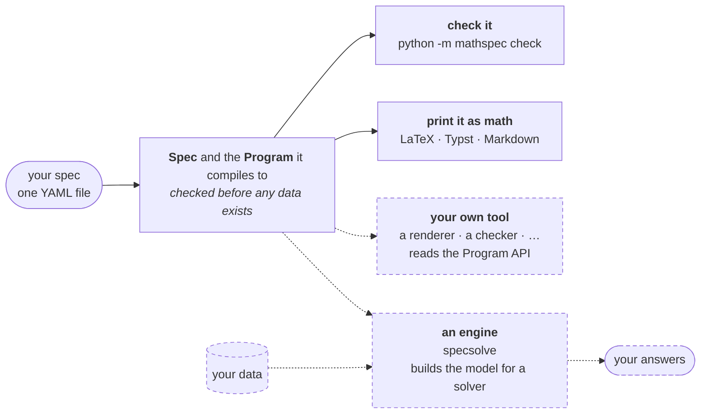

<!--
SPDX-FileCopyrightText: mathspec contributors
SPDX-License-Identifier: CC-BY-4.0
-->

# mathspec

<!--- --8<-- [start:badges] -->

[](https://github.com/energy-models/mathspec/actions/workflows/ci.yml)
[](https://prefix.dev/channels/conda-forge/packages/mathspec)
[](https://pypi.org/project/mathspec)
[](https://pypi.org/project/mathspec)
[](https://mathspec.readthedocs.io)

<!--- --8<-- [end:badges] -->

<!--- --8<-- [start:tagline] -->

**Write the specification (spec) of an optimisation model as a YAML file. Check it and print it
as math, with no data and no solver.**

<!--- --8<-- [end:tagline] -->

<!--- --8<-- [start:spec] -->

A spec declares four things:

- the dimensions it is indexed over, such as `snapshot` and `generator`
- the parameters it takes as data, such as `load` and `cost`
- the decisions a solver makes, such as `dispatch`
- the rules those decisions obey, such as `sum(dispatch, over=generator) == load`

A spec contains no data. A tool that builds the model (an
[engine](https://mathspec.readthedocs.io/en/latest/reference/glossary/#tool))
attaches the data to the spec. The file below is a complete spec.

<!--- --8<-- [end:spec] -->

<!--- --8<-- [start:benefits] -->

- **Check a spec with no data.** mathspec refuses a misspelt name or a
  dimension mismatch at load, so a spec is checked in continuous integration
  (CI) like code.
  [Errors →](https://mathspec.readthedocs.io/en/latest/reference/language/errors/)
- **Publish the math you solve.** One file states the spec. An engine builds
  the model from it, and mathspec prints its equations for a paper.
  [Typeset →](https://mathspec.readthedocs.io/en/latest/reference/typeset/)
- **One spec, many tools.** Engines, renderers (tools that print a spec) and
  checkers read a spec through one interface, so no two read a file differently.
  [Program API →](https://mathspec.readthedocs.io/en/latest/reference/program/)
- **Write full-size specs.** The model that `n.optimize()` builds in the power
  system framework PyPSA is one spec file, with its stochastic, multi-period
  and quadratic classes.
  [PyPSA in one file →](https://mathspec.readthedocs.io/en/latest/examples/pypsa_ladder/)

<!--- --8<-- [end:benefits] -->

## Example

<!--- --8<-- [start:model] -->

```yaml title="dispatch.yaml"
description: Least-cost dispatch of a generator fleet against a load in each dispatch period.

dimensions:
  snapshot: { dtype: int, description: dispatch periods }
  generator: { description: generating units }

parameters:
  capacity: { dims: [generator], description: installed capacity }
  load: { dims: [snapshot], description: demand to be met }
  cost: { dims: [generator], description: marginal cost }

variables:
  dispatch:
    description: output of a generator in a snapshot
    dims: [snapshot, generator]
    where: "capacity > 0"
    bounds: { lower: 0, upper: capacity }

constraints:
  power_balance:
    dims: [snapshot]
    expression: sum(dispatch, over=generator) == load

objective:
  sense: minimize
  expression: sum(dispatch * cost)
```

<!--- --8<-- [end:model] -->

### The math it prints

mathspec prints the file above as math. Markdown is one of the three formats
of mathspec, and GitHub renders the Markdown below.

<!-- Prettier pads the legend tables that the generator emits unpadded, so the
     two would rewrite each other forever. The range keeps this file formatted
     and the block below byte-for-byte what the typesetter printed. -->
<!-- prettier-ignore-start -->
<!-- readme-math:begin -->

Least-cost dispatch of a generator fleet against a load in each dispatch period.

#### Variable domains

**`dispatch`**

```math
0 \le \mathit{dispatch}_{t,g} \le \mathrm{capacity}_{g} \qquad \forall\, t \in \mathcal{T},\ g \in \mathcal{G} \,:\, \mathrm{capacity}_{g} > 0
```

#### Objective

```math
\min \sum_{t \in \mathcal{T},\ g \in \mathcal{G}} \mathit{dispatch}_{t,g} \cdot \mathrm{cost}_{g}
```

#### Subject to

**`power_balance`**

```math
\sum_{g \in \mathcal{G}} \mathit{dispatch}_{t,g} = \mathrm{load}_{t} \qquad \forall\, t \in \mathcal{T}
```

<details>
<summary>The whole document: a symbol table, and the legend it prints</summary>

Least-cost dispatch of a generator fleet against a load in each dispatch period.

#### Sets

| Symbol | Meaning |
|---|---|
| $`\mathcal{S}`$ | index $`s`$ — `snapshot` — dispatch periods |
| $`\mathcal{G}`$ | index $`g`$ — `generator` — generating units |

#### Parameters

| Symbol | Meaning |
|---|---|
| $`\bar p`$ | `capacity` over $`\mathcal{G}`$ — installed capacity |
| $`\ell`$ | `load` over $`\mathcal{S}`$ — demand to be met |
| $`c`$ | `cost` over $`\mathcal{G}`$ — marginal cost |

#### Variables

| Symbol | Meaning |
|---|---|
| $`\mathit{dispatch}`$ | `dispatch` over $`\mathcal{S} \times \mathcal{G}`$ — output of a generator in a snapshot |

#### Variable domains

**`dispatch`**

$`0 \le \mathit{dispatch}_{s,g} \le \bar p_{g} \qquad \forall\, s \in \mathcal{S},\ g \in \mathcal{G} \,:\, \bar p_{g} > 0`$

#### Objective

$`\min \sum_{s \in \mathcal{S},\ g \in \mathcal{G}} \mathit{dispatch}_{s,g} \cdot c_{g}`$

#### Subject to

**`power_balance`**

$`\sum_{g \in \mathcal{G}} \mathit{dispatch}_{s,g} = \ell_{s} \qquad \forall\, s \in \mathcal{S}`$

</details>

<!-- readme-math:end -->
<!-- prettier-ignore-end -->

Each format is one call in Python:

```python
import mathspec as ms

spec = ms.to_spec('dispatch.yaml')

ms.to_markdown(spec)
ms.to_latex(spec)
ms.to_typst(spec)
```

`to_spec` loads and checks the file, and each of the three calls returns the
spec as text in one format. A
[symbol table](https://mathspec.readthedocs.io/en/latest/reference/typeset/#symbol-tables)
sets the symbol for each name, as in the folded block, where `load` prints as
$`\ell`$. The same calls run as shell commands, as
[Print a spec as math](https://mathspec.readthedocs.io/en/latest/howto/print/)
lists them.

## Engines and other tools

<!--- --8<-- [start:engines] -->

An engine, such as [specsolve](https://github.com/fluxopt/specsolve), attaches
data to a spec, builds the model and hands it to a solver. mathspec itself
builds no model. Any other tool, such as a renderer or a checker, reads the
same spec through the
[Program API](https://mathspec.readthedocs.io/en/latest/reference/program/).
In the diagram, the solid boxes are mathspec and the dashed boxes are outside
it.



<!--- --8<-- [end:engines] -->

## Documentation

The documentation is at <https://mathspec.readthedocs.io>. In
[the first tutorial](https://mathspec.readthedocs.io/en/latest/tutorials/first-spec/)
you build the file above one section at a time.

## Installation

[Install mathspec](https://mathspec.readthedocs.io/en/latest/howto/installation/)
from PyPI with pip, uv or pixi. To work on mathspec itself, set up a
[development environment](https://mathspec.readthedocs.io/en/latest/contributing/#setting-up-a-development-environment).

## Background

<!--- --8<-- [start:background] -->

mathspec started life as YAML math in the energy system modelling framework [Calliope](https://github.com/calliope-project/calliope).
The Calliope maintainers developed many of the language elements mathspec uses today, from [initial concepts in 2020](https://github.com/calliope-project/calliope/issues/100#issuecomment-682017208) to their [first stable release](https://github.com/calliope-project/calliope/releases/tag/v0.7.0) using 100% YAML math in September 2026.

mathspec is an evolution of the initial Calliope work, ported to a framework-agnostic organisation and now developed as a cross-framework initiative.
This initiative has proven a success, with improvements in syntax, performance, and features realised already in the first months.
Our aim is to develop a human-readable math language that can be used across the energy modelling community (and beyond!) to increase transparency, shareability, and readability of our math.

For more information see our
[Background and history page](https://mathspec.readthedocs.io/en/latest/about/history/).

<!--- --8<-- [end:background] -->

## Status

<!--- --8<-- [start:status] -->

mathspec is alpha software and makes no compatibility promise yet.
**Breaking changes land without a deprecation cycle.** If you depend on
mathspec, pin an exact version, and read the
[changelog](https://github.com/energy-models/mathspec/blob/main/CHANGELOG.md)
before you upgrade. The test suite passes every construct through the schema,
the parsers and all three typeset formats, and compiles the LaTeX.

<!--- --8<-- [end:status] -->

## Contributors

Thanks go to these people
([emoji key](https://allcontributors.org/docs/en/emoji-key)). The
all-contributors bot keeps the table below. To add someone, comment
`@all-contributors please add @login for code` on an issue.

<!--- --8<-- [start:contributors] -->
<!-- ALL-CONTRIBUTORS-LIST:START - Do not remove or modify this section -->
<!-- prettier-ignore-start -->
<!-- markdownlint-disable -->
<table>
  <tbody>
    <tr>
      <td align="center" valign="top" width="14.28%"><a href="https://github.com/brynpickering"><br /><sub><b>Bryn Pickering</b></sub></a><br /><a href="https://github.com/search?type=pullrequests&q=is%3Apr+author%3Abrynpickering+%28repo%3Aenergy-models%2Fmathspec+OR+%28repo%3Acalliope-project%2Fcalliope+created%3A2023-01-01..2026-08-13%29%29&s=created&o=desc" title="Code">💻</a> <a href="https://github.com/search?type=commits&q=author%3Abrynpickering+repo%3Aenergy-models%2Fmathspec&s=committer-date&o=desc" title="Documentation">📖</a> <a href="https://github.com/search?type=issues&q=is%3Aissue+author%3Abrynpickering+%28repo%3Aenergy-models%2Fmathspec+OR+%28repo%3Acalliope-project%2Fcalliope+created%3A2018-04-16..2026-08-13%29%29&s=created&o=desc" title="Ideas, Planning, & Feedback">🤔</a> <a href="https://github.com/search?type=issues&q=is%3Aissue+author%3Abrynpickering+%28repo%3Aenergy-models%2Fmathspec+OR+%28repo%3Acalliope-project%2Fcalliope+created%3A2018-04-16..2026-08-13%29%29&s=created&o=desc" title="Project Management">📆</a> <a href="https://github.com/search?type=pullrequests&q=is%3Apr+author%3Abrynpickering+%28repo%3Aenergy-models%2Fmathspec+OR+%28repo%3Acalliope-project%2Fcalliope+created%3A2018-04-16..2026-08-13%29%29&s=created&o=desc" title="Maintenance">🚧</a> <a href="https://github.com/search?type=pullrequests&q=is%3Apr+reviewed-by%3Abrynpickering+%28repo%3Aenergy-models%2Fmathspec+OR+%28repo%3Acalliope-project%2Fcalliope+created%3A2023-01-01..2026-08-13%29%29&s=created&o=desc" title="Reviewed Pull Requests">👀</a> <a href="https://github.com/search?type=commits&q=author%3Abrynpickering+repo%3Aenergy-models%2Fmathspec&s=committer-date&o=desc" title="Infrastructure (Hosting, Build-Tools, etc)">🚇</a></td>
      <td align="center" valign="top" width="14.28%"><a href="http://fxbumann.de"><br /><sub><b>Felix Bumann</b></sub></a><br /><a href="https://github.com/search?type=commits&q=author%3AFBumann+repo%3Aenergy-models%2Fmathspec&s=committer-date&o=desc" title="Code">💻</a> <a href="https://github.com/search?type=commits&q=author%3AFBumann+repo%3Aenergy-models%2Fmathspec&s=committer-date&o=desc" title="Documentation">📖</a> <a href="https://github.com/search?type=commits&q=author%3AFBumann+repo%3Aenergy-models%2Fmathspec&s=committer-date&o=desc" title="Tests">⚠️</a> <a href="https://github.com/search?type=commits&q=author%3AFBumann+repo%3Aenergy-models%2Fmathspec&s=committer-date&o=desc" title="Infrastructure (Hosting, Build-Tools, etc)">🚇</a> <a href="https://github.com/search?type=pullrequests&q=is%3Apr+author%3AFBumann+%28repo%3Aenergy-models%2Fmathspec+OR+%28repo%3Afluxopt%2Fspecsolve+created%3A%3C2026-08-21%29%29&s=created&o=desc" title="Maintenance">🚧</a> <a href="https://github.com/search?type=issues&q=is%3Aissue+author%3AFBumann+%28repo%3Aenergy-models%2Fmathspec+OR+%28repo%3Afluxopt%2Fspecsolve+created%3A%3C2026-08-21%29%29&s=created&o=desc" title="Ideas, Planning, & Feedback">🤔</a> <a href="https://github.com/search?type=pullrequests&q=is%3Apr+reviewed-by%3AFBumann+%28repo%3Aenergy-models%2Fmathspec+OR+%28repo%3Afluxopt%2Fspecsolve+created%3A%3C2026-08-21%29%29&s=created&o=desc" title="Reviewed Pull Requests">👀</a></td>
      <td align="center" valign="top" width="14.28%"><a href="http://fabianhofmann.org"><br /><sub><b>Fabian Hofmann</b></sub></a><br /><a href="https://github.com/search?type=commits&q=author%3AFabianHofmann+repo%3Aenergy-models%2Fmathspec&s=committer-date&o=desc" title="Code">💻</a> <a href="https://github.com/search?type=commits&q=author%3AFabianHofmann+repo%3Aenergy-models%2Fmathspec&s=committer-date&o=desc" title="Documentation">📖</a> <a href="https://github.com/search?type=issues&q=is%3Aissue+author%3AFabianHofmann+%28repo%3Aenergy-models%2Fmathspec+OR+%28repo%3Afluxopt%2Fspecsolve+created%3A%3C2026-08-21%29%29&s=created&o=desc" title="Bug reports">🐛</a> <a href="https://github.com/search?type=issues&q=is%3Aissue+author%3AFabianHofmann+%28repo%3Aenergy-models%2Fmathspec+OR+%28repo%3Afluxopt%2Fspecsolve+created%3A%3C2026-08-21%29%29&s=created&o=desc" title="Ideas, Planning, & Feedback">🤔</a> <a href="https://github.com/search?type=pullrequests&q=is%3Apr+reviewed-by%3AFabianHofmann+%28repo%3Aenergy-models%2Fmathspec+OR+%28repo%3Afluxopt%2Fspecsolve+created%3A%3C2026-08-21%29%29&s=created&o=desc" title="Reviewed Pull Requests">👀</a> <a href="https://github.com/search?type=pullrequests&q=is%3Apr+author%3AFabianHofmann+%28repo%3Aenergy-models%2Fmathspec+OR+%28repo%3Afluxopt%2Fspecsolve+created%3A%3C2026-08-21%29%29&s=created&o=desc" title="Maintenance">🚧</a></td>
      <td align="center" valign="top" width="14.28%"><a href="https://github.com/coroa"><br /><sub><b>Jonas Hörsch</b></sub></a><br /><a href="https://github.com/energy-models/mathspec/commits?author=coroa" title="Code">💻</a> <a href="#ideas-coroa" title="Ideas, Planning, & Feedback">🤔</a> <a href="https://github.com/energy-models/mathspec/pulls?q=is%3Apr+reviewed-by%3Acoroa" title="Reviewed Pull Requests">👀</a></td>
      <td align="center" valign="top" width="14.28%"><a href="http://www.pfenninger.org"><br /><sub><b>Stefan Pfenninger-Lee</b></sub></a><br /><a href="https://github.com/search?type=issues&q=is%3Aissue+author%3Asjpfenninger+%28repo%3Aenergy-models%2Fmathspec+OR+%28repo%3Acalliope-project%2Fcalliope+created%3A2018-04-16..2026-08-13%29%29&s=created&o=desc" title="Ideas, Planning, & Feedback">🤔</a> <a href="https://github.com/search?type=pullrequests&q=is%3Apr+reviewed-by%3Asjpfenninger+%28repo%3Aenergy-models%2Fmathspec+OR+%28repo%3Acalliope-project%2Fcalliope+created%3A2023-01-01..2026-08-13%29%29&s=created&o=desc" title="Reviewed Pull Requests">👀</a></td>
      <td align="center" valign="top" width="14.28%"><a href="https://orcid.org/0000-0003-2288-6423"><br /><sub><b>Ivan Ruiz Manuel</b></sub></a><br /><a href="https://github.com/search?type=issues&q=is%3Aissue+author%3Airm-codebase+%28repo%3Aenergy-models%2Fmathspec+OR+%28repo%3Acalliope-project%2Fcalliope+created%3A2018-04-16..2026-08-13%29%29&s=created&o=desc" title="Ideas, Planning, & Feedback">🤔</a> <a href="https://github.com/search?type=pullrequests&q=is%3Apr+reviewed-by%3Airm-codebase+%28repo%3Aenergy-models%2Fmathspec+OR+%28repo%3Acalliope-project%2Fcalliope+created%3A2023-01-01..2026-08-13%29%29&s=created&o=desc" title="Reviewed Pull Requests">👀</a></td>
      <td align="center" valign="top" width="14.28%"><a href="https://cp.ethz.ch/people/person-detail.tim-troendle.html"><br /><sub><b>Tim Tröndle</b></sub></a><br /><a href="https://github.com/search?type=issues&q=is%3Aissue+author%3Atimtroendle+%28repo%3Aenergy-models%2Fmathspec+OR+%28repo%3Acalliope-project%2Fcalliope+created%3A2018-04-16..2026-08-13%29%29&s=created&o=desc" title="Ideas, Planning, & Feedback">🤔</a></td>
    </tr>
    <tr>
      <td align="center" valign="top" width="14.28%"><a href="https://github.com/jnnr"><br /><sub><b>Jann Launer</b></sub></a><br /><a href="https://github.com/search?type=issues&q=is%3Aissue+author%3Ajnnr+%28repo%3Aenergy-models%2Fmathspec+OR+%28repo%3Acalliope-project%2Fcalliope+created%3A2018-04-16..2026-08-13%29%29&s=created&o=desc" title="Ideas, Planning, & Feedback">🤔</a> <a href="https://github.com/search?type=issues&q=is%3Aissue+author%3Ajnnr+%28repo%3Aenergy-models%2Fmathspec+OR+%28repo%3Acalliope-project%2Fcalliope+created%3A2018-04-16..2026-08-13%29%29&s=created&o=desc" title="Bug reports">🐛</a></td>
      <td align="center" valign="top" width="14.28%"><a href="http://www.flombardi.org"><br /><sub><b>Francesco Lombardi</b></sub></a><br /><a href="https://github.com/search?type=issues&q=is%3Aissue+author%3AFLomb+%28repo%3Aenergy-models%2Fmathspec+OR+%28repo%3Acalliope-project%2Fcalliope+created%3A2018-04-16..2026-08-13%29%29&s=created&o=desc" title="Bug reports">🐛</a></td>
      <td align="center" valign="top" width="14.28%"><a href="https://github.com/jmorrisnrel"><br /><sub><b>James Morris</b></sub></a><br /><a href="https://github.com/search?type=issues&q=is%3Aissue+author%3Ajmorrisnrel+%28repo%3Aenergy-models%2Fmathspec+OR+%28repo%3Acalliope-project%2Fcalliope+created%3A2018-04-16..2026-08-13%29%29&s=created&o=desc" title="Bug reports">🐛</a></td>
      <td align="center" valign="top" width="14.28%"><a href="https://github.com/sstroemer"><br /><sub><b>Stefan Strömer</b></sub></a><br /><a href="https://github.com/search?type=issues&q=is%3Aissue+author%3Asstroemer+%28repo%3Aenergy-models%2Fmathspec+OR+%28repo%3Acalliope-project%2Fcalliope+created%3A2018-04-16..2026-08-13%29%29&s=created&o=desc" title="Bug reports">🐛</a></td>
      <td align="center" valign="top" width="14.28%"><a href="https://portalrecerca.uab.cat/en/persons/alexander-de-tom%C3%A1s-pascual"><br /><sub><b>Alexander de Tomás Pascual</b></sub></a><br /><a href="https://github.com/search?type=issues&q=is%3Aissue+author%3ALexPascal+%28repo%3Aenergy-models%2Fmathspec+OR+%28repo%3Acalliope-project%2Fcalliope+created%3A2018-04-16..2026-08-13%29%29&s=created&o=desc" title="Bug reports">🐛</a></td>
    </tr>
  </tbody>
</table>

<!-- markdownlint-restore -->
<!-- prettier-ignore-end -->

<!-- ALL-CONTRIBUTORS-LIST:END -->
<!--- --8<-- [end:contributors] -->

## Licence

The code is [MIT](https://github.com/energy-models/mathspec/blob/main/LICENSE), and the prose is
[CC-BY-4.0](https://github.com/energy-models/mathspec/blob/main/LICENSES/CC-BY-4.0.txt).
